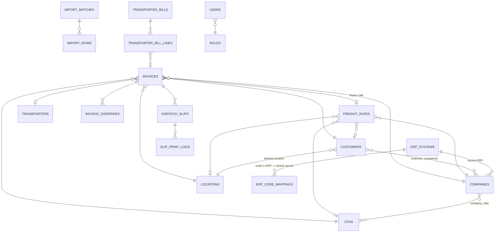

# Database

PostgreSQL 16 (production) or SQLite (demo). Schema is managed by **Alembic** (`migrations/`). Apply with
`python -m app.cli init-db` (also runs automatically in the Docker entrypoint).

## Entity overview

## Tables

| Table | Purpose / key columns |
|---|---|
| `roles` | code, name, `permissions` (JSON list; `*` = all) |
| `users`, `user_companies`, `user_cfas` | login, bcrypt hash, role, `all_companies` / `all_cfas` scope flags, lock-out fields |
| `user_sessions` | SHA-256 of the session token, last seen, IP, user agent, revoked |
| `erp_systems` | code (MARG/SAP/CBO/INTRECT/…), adapter key, mode, JSON config, API-key hash, last sync |
| `erp_code_mappings` | (erp, entity type, optional company scope, source code) → central target id |
| `erp_field_mappings` | per ERP: central invoice field ← source field (API/adapter payloads) |
| `companies`, `company_cfas` | principal master; source ERP; applicable CFAs |
| `cfas` | CFA / warehouse master |
| `locations` | delivery location / route / zone / distance |
| `customers`, `customer_companies`, `customer_cfas` | party master; delivery location; `merged_into_id` for merged duplicates |
| `transporters` | transporter master incl. GST, PAN, service area, payment terms |
| `freight_rates` | company, cfa?, customer?, location?, `is_default`, rate, effective from/to, status (PENDING_APPROVAL/APPROVED/REJECTED/INACTIVE), created/approved by+at, `previous_rate_id` |
| `import_templates` | reusable column map + date format per ERP export |
| `import_batches`, `import_rows` | every upload / push / adapter run; raw + mapped row data, errors, warnings, resulting invoice |
| `invoices` | the normalised central invoice **plus** its dispatch and transportation expense (see below) |
| `invoice_overrides` | field, old, new, reason, requester, status, approver, decision remarks |
| `dispatch_slips` | unique `dispatch_no`, immutable JSON snapshot, void info |
| `slip_print_logs` | print number, reprint flag, output (PRINT/PDF × A4/A5), reason, user, IP, time |
| `transporter_bills`, `transporter_bill_lines` | bill header, period, amounts, variance, status; lines matched to invoices |
| `audit_logs` | ts, user, action, module, record type/id, ref, field, old, new, reason, IP, session, details JSON |
| `settings` | configurable controls (typed key/value) |
| `sequences` | row-locked counters (dispatch numbers per CFA+FY, import batch numbers) |
| `integration_runs` | adapter sync history |

### `invoices` (normalised invoice structure)

Identity & source: `id` (central id shown as `CI00000123`), `source_erp_id`, `source_invoice_id`, `company_id`,
`cfa_id`, `customer_id`, `customer_code` (as received), `location_id`, `invoice_no`, `invoice_date`, `fiscal_year`,
`sales_value`.
Freight: `boxes`, `boxes_source` (ERP/MANUAL/OVERRIDE), `freight_rate_id`, `rate_per_box`, `rate_level`,
`freight_amount`, `freight_basis` (AUTO/MANUAL_RATE/MANUAL_AMOUNT), `freight_calculated_at`.
Workflow: `status`, `exception_code`, `exception_reason`, `verified_by/at`, `slip_generated_by/at`,
`first_printed_by/at`, `print_count`, `completed_by/at`, `cancelled_by/at`, `cancel_reason`.
Dispatch: `transporter_id`, `vehicle_no`, `lr_no`, `dispatch_date`, `dispatch_time`, `remarks`, `dispatch_no`.
Reconciliation: `actual_freight`, `transporter_bill_id`. Sync: `import_batch_id`, `imported_at/by`,
`erp_sync_status`, `erp_synced_at`. Audit: `created_at`, `updated_at`, `version` (optimistic lock).

**Duplicate prevention**: unique `(company_id, cfa_id, fiscal_year, invoice_no)`; plus a check on
`(source_erp_id, source_invoice_id)` and within-file duplicates during import.

Indexes: status+invoice_date, company+cfa+invoice_date, dispatch_date, lr_no, customer, location, transporter,
dispatch_no; audit by record and timestamp; freight-rate lookup index.

Money is `NUMERIC` (12–14,2) and computed with Python `Decimal`; timestamps are stored in UTC and shown in IST;
dispatch date/time are local business values.

## Backup & restore

* Docker: the `backup` service runs `deploy/backup.sh` every 24 h → `./backups/ctdms-YYYYMMDD-HHMMSS.dump`
  (pg_dump custom format), keeps `BACKUP_KEEP_DAYS` (30). Add rclone / S3 lines for off-site copies.
* Plain server: `python -m app.cli backup --keep 30` (pg_dump or SQLite online backup) from cron
  (`deploy/crontab.example`).
* Restore PostgreSQL: `pg_restore --clean --no-owner -d ctdms backups/ctdms-….dump`
* Restore SQLite: stop the app, copy the `.sqlite3` backup over `data/ctdms.db`.
* Data ownership: *Administration › Users › Full data export (ZIP)* downloads every table as CSV (password and key
  hashes excluded); every report exports to Excel/CSV.
